# ⚡ Alvi Rownok
<!-- markdownlint-disable MD013 -->

## AI and Software Expert • Software Developer (Level C1)

**[GAM Engineering S.r.l.](https://gamengineering.it)** • *Aversa, CE, Italy*

|  |  |
| :---: | :---: |

> "Just a developer and AI engineer for fun... 1 commit, 0 production bottlenecks."

---

## 👨‍💻 Executive Profile & Engineering Philosophy

I am an **AI and Software Expert** and certified **Software Developer (Level C1)** at **GAM Engineering S.r.l.**, designing mission-critical systems across **Artificial Intelligence / Computer Vision**, **Enterprise Systems Architecture**, and **Telecommunications Telemetry**.

My engineering practice follows strict international quality standards (**ISO 9001:2015**, **ISO/IEC 27001**) and European regulatory governance (**GDPR EU 2016/679**, **NIS2 Directive EU 2022/2555**, **EU AI Act Regulation EU 2024/1689**), ensuring that software solutions deliver verified reliability, tamper-resistant data privacy, and mathematical robustness.

---

## 🚀 Key Products & Projects Portfolio

### 1. 🛡️ Ghostymizer — Video Privacy & Anonymization Engine

* **Brief Identity:** An active engineering project focused on Computer Vision and Edge AI models for automated, real-time facial and license-plate privacy anonymization across video surveillance streams.
* **Objective:** Developing resilient visual redaction under dynamic camera conditions while aligning with European data protection frameworks (GDPR Art. 9/25 & EU AI Act).

### 2. ⚡ GAMAdPro — Enterprise Device Licensing & Security SaaS

* **Brief Identity:** An enterprise-grade B2B platform designed for centralized device lifecycle licensing, digital advertising operations, and intelligent endpoint telemetry management.
* **Core Value:** Combines interactive 3D WebGL operational dashboards with robust access control, automated privilege succession, and continuous subscription validation.

### 3. 🌐 FASTWEB-Logistics

* **Brief Identity:** An ongoing enterprise logistics and supply-chain management solution covering telecommunications, internet network infrastructure, and data center supply chains.
* **Core Value:** Optimizing network location discovery, inventory movement, resource routing, and automated supply-chain verification across distributed infrastructure.

### 4. 📡 Network-to-Telegram — WISP Telemetry & Signaling Tool

* **Brief Identity:** A specialized telecommunications signaling and monitoring utility connecting WISP (Wireless Internet Service Provider) network infrastructure to Telegram for real-time operational alerts, link health metrics, and instant uptime dispatching.

### 5. 📋 GAM-PM — Smart Project Management

* **Brief Identity:** A personal design and architecture initiative focused on intelligent, automated project management, streamlined developer workflows, and background synchronization services.

### 6. 🔍 Digital Forensics & Incident Response

* **Brief Identity:** Automated forensic log analysis and evidence synthesis pipelines built to support incident handling and compliance verification, strictly adhering to ISO/IEC 27001 and NIS2 Article 23 CSIRT reporting protocols.

---

## 🛠️ Technical Competencies

| Domain | Core Competencies |
| :--- | :--- |
| **Artificial Intelligence & Vision** | Deep Learning • Computer Vision • Edge AI • Real-Time Object Tracking • Video Anonymization |
| **Programming Languages** | Python • C/C++ • TypeScript • JavaScript • SQL • Ruby • Bash • PowerShell |
| **Backend & Distributed Systems** | REST APIs • Asynchronous Queue Systems • High-Availability Pipelines • PostgreSQL • Microservices |
| **Frontend & Visualization** | Modern Web Applications • 3D WebGL Dashboards • Interactive Telemetry UIs |
| **DevOps & Cloud Systems** | Docker Containers • Linux System Administration • Zero-Trust Edge Ingress • Secure Reverse Proxies |
| **Governance & Compliance** | GDPR (EU 2016/679) • NIS2 Directive • EU AI Act (2024) • ISO 9001:2015 • ISO/IEC 27001 |

---

## 📊 Diagnostics & Activity

|  |  |
| :---: | :---: |

---

## 📜 Standards & Compliance Highlights

Every enterprise system and AI model I architect is developed in strict adherence to:

* 🇪🇺 **EU AI Act — Regulation (EU) 2024/1689:** Prohibited AI guardrails (Art. 5), comprehensive documentation (Art. 11), automatic activity logging (Art. 12/19), and human oversight controls (Art. 14).
* 🔒 **GDPR — Regulation (EU) 2016/679:** Data protection by design and default (Art. 25), sensitive data isolation (Art. 9), data minimization (Art. 5), and breach response readiness (Art. 33).
* 🛡️ **NIS2 Directive — Directive (EU) 2022/2555:** Risk analysis, zero-trust hygiene, and CSIRT incident reporting protocols.
* 📋 **ISO Benchmarks:** ISO 9001:2015 (Quality Management) • ISO/IEC 27001 (Information Security Management).

---

## 📬 Connect & Collaborate

Crafted with precision, Linux terminal excellence, and full privacy compliance by Alvi Rownok • Aversa, CE, Italy
